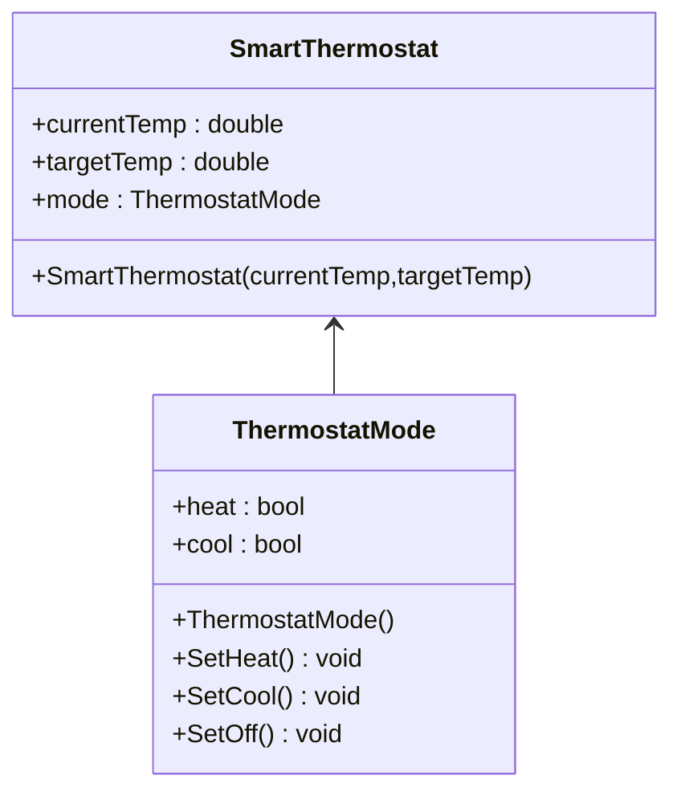
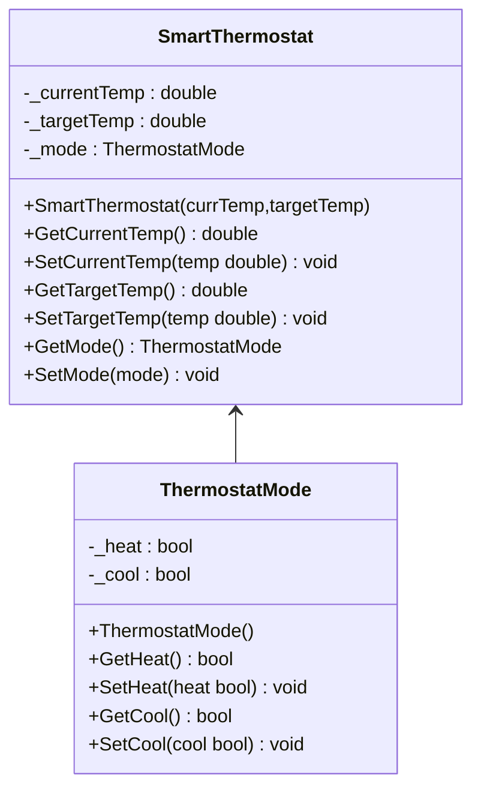
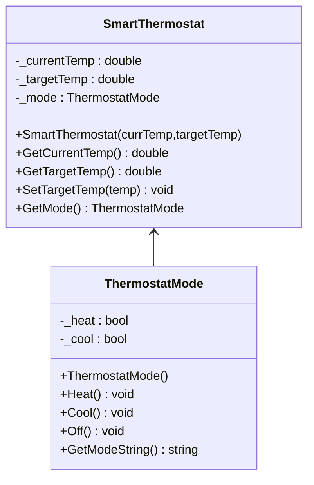
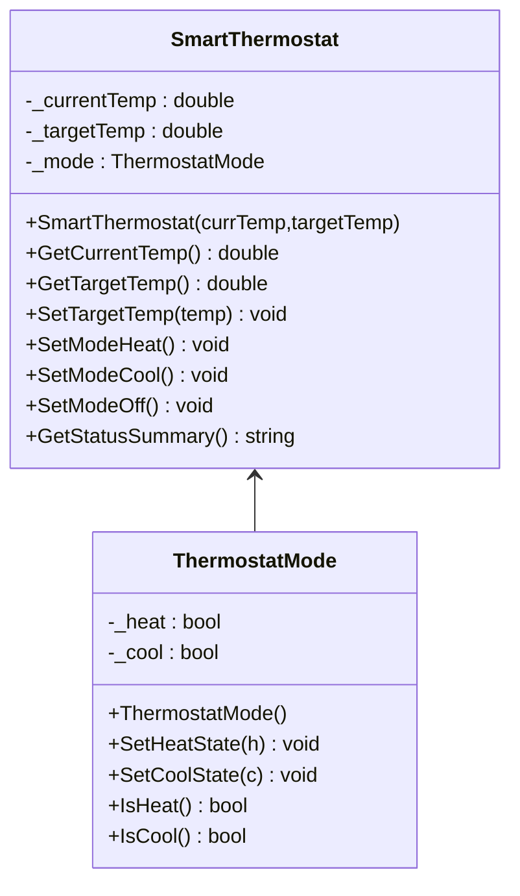
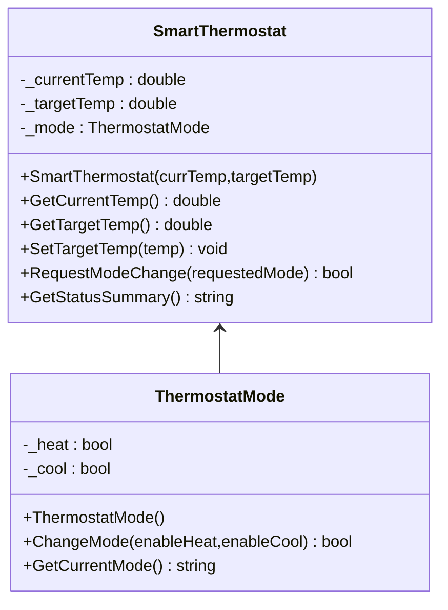
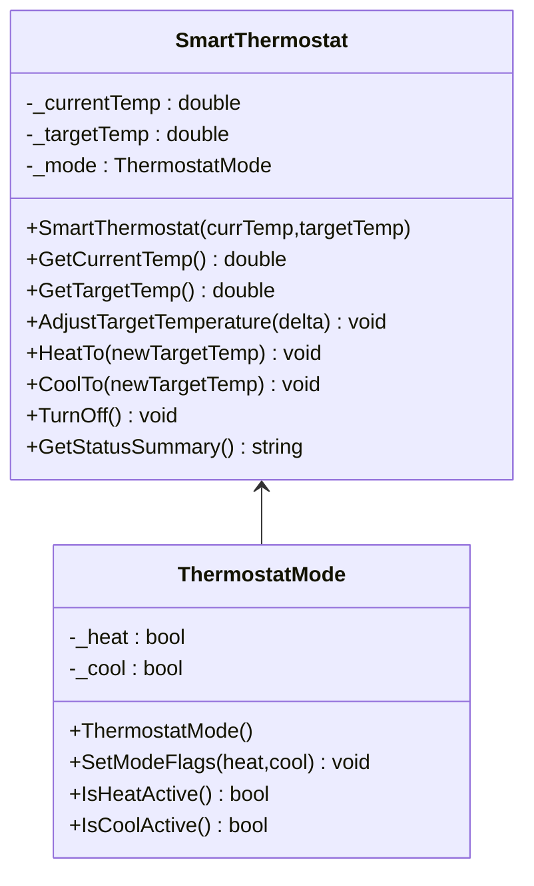

# Application Exercise "Smart Thermostat"

## Scenario

Your team is designing the core control system for a Smart Thermostat. The system needs to track temperature readings and control the heating/cooling modes. Rules:

1. Target temperatures must always be between 50 and 90 ℉.
2. The thermostat can be in *heat*, *cool*, or *off* mode; it must never have both heating and cooling active at the same time.
3. The system must not switch to *heat* mode if the target temperature is lower than the current temperature; likewise, it must not switch to *cool* mode if the target temperature is higher than the current temperature.

You're deciding how to divide responsibilities between two classes:

- `ThermostatMode`: responsible for boolean states `_heatMode`, `_coolMode`.
- `SmartThermostat`: responsible for temperatures.

Below are proposed class designs.

## Question

Which UML design best protects the system from entering an invalid or unsafe state, while keeping class responsibilities clean and properly encapsulated?

### Option A: Public Direct Access (Open Mutation)

### Option B: Pure Getter/Setter Pass-Through

### Option C: Delegated Mode Guarding (Smart Mode, Exposed Sub-Object)

### Option D: Centralized Thermostat Guarding (Fully Hidden Mode Object)

### Option E: Coordinated Dual-Guarding (Shared Validation Responsibilities)

### Option F: Intent-Based Domain Actions (Action Methods Only)

